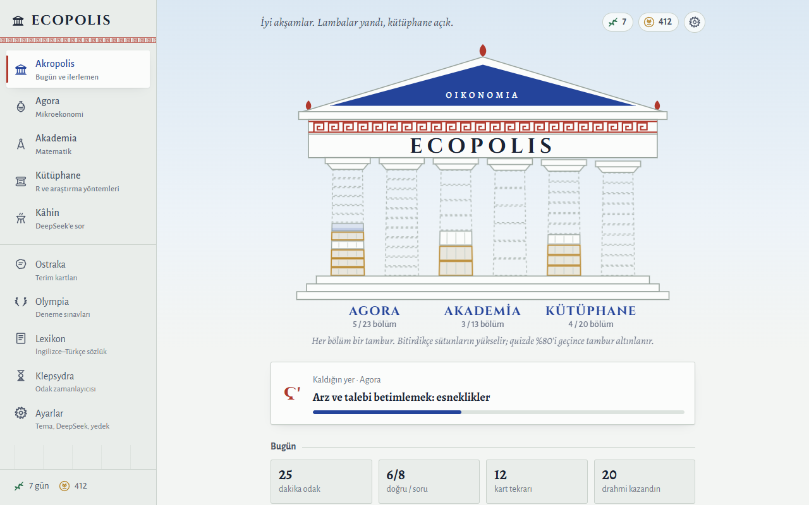
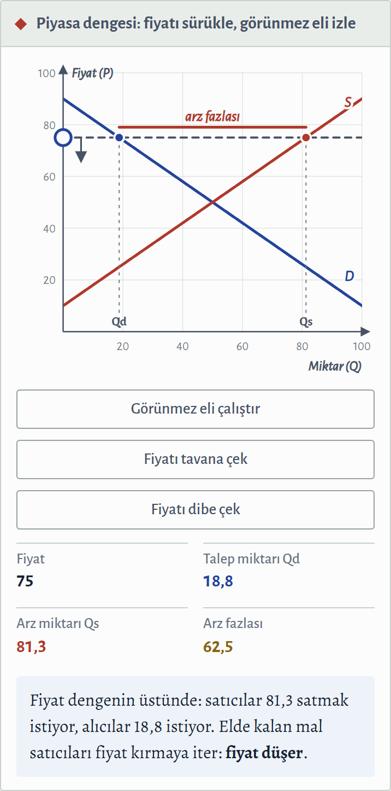
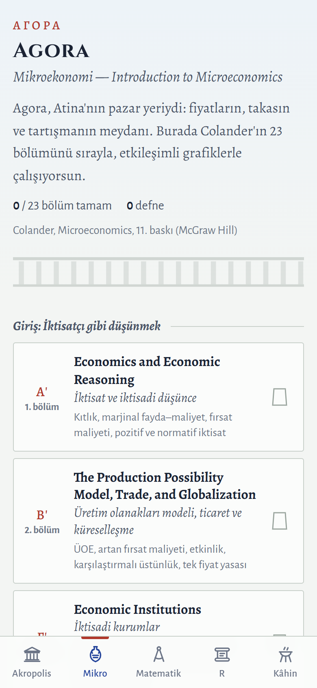
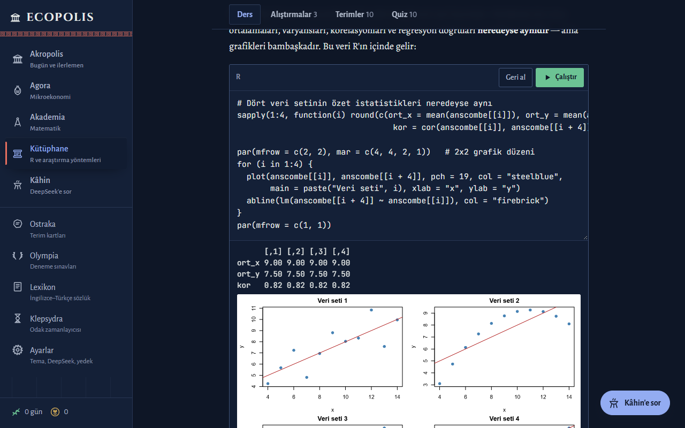

# Ecopolis

İktisat 1. sınıfın üç ana dersi için antik Yunan esintili, etkileşimli bir çalışma uygulaması.
Telefonda ve bilgisayarda çalışır, kurulum istemez, ilk açılıştan sonra internetsiz de açılır.

**Uygulamayı aç:** https://ascarry-eng.github.io/Ecopolis/



## Üç ders, üç mekân

| Mekân | Ders | İçerik |
|---|---|---|
| **Agora** | Mikroekonomiye Giriş | Colander, *Microeconomics* 11. baskının 23 bölümü, kitabın sırasıyla |
| **Akademia** | Matematik | 13 haftalık konu + matrisler (ek konu), vize/final deneme sınavları |
| **Kütüphane** | Bilgisayar Uygulamalı Araştırma Yöntemleri | Sıfırdan R, istatistik ve araştırma tasarımı — 20 ders |

Anlatım Türkçe; terimler ve quiz soruları İngilizce, açıklamaları Türkçe (sınav İngilizce olduğu için).

<p align="center">
  
  
</p>

## Neler var

- **59 etkileşimli görsel.** Arz–talep, esneklik, vergi yükü, maliyet eğrileri, piyasa yapıları, Lorenz eğrisi,
  türev/integral, normal dağılım, regresyon… Eğriyi sürükle, kaydırıcıyı oynat, sonucu anında gör.
- **Gerçek R, tarayıcının içinde.** Kütüphane derslerindeki kod kutuları [webR](https://docs.r-wasm.org/webr/) ile
  çalışır: RStudio kurmadan `lm()`, `ggplot2`, `dplyr` denenir. 56 alıştırmanın her biri kodunu gerçekten çalıştırıp denetler.
- **Kâhin (DeepSeek).** Bulunduğun bölümü bilerek anlatır, Sokratik soru sorar, quiz üretir, grafik çizer,
  R kodunu açıklar; ödev fotoğrafını okuyabilir.
- **615 quiz sorusu, 729 terim.** Her bölümün sonunda quiz; yanlışların *yanlış defterine* düşer.
- **Ostraka** — aralıklı tekrarlı terim kartları. **Olympia** — karma deneme sınavları.
  **Lexikon** — İngilizce–Türkçe sözlük. **Klepsydra** — odak zamanlayıcısı.
- **İlerleme tapınağı.** Her bölüm bir tambur; bitirdikçe sütunlar yükselir, quizde %80'i geçince tambur altınlanır.
- Açık ve koyu tema ("Ege gecesi"), telefonda alt çubuk, bilgisayarda yan menü.



## Kullanım

1. Bağlantıyı aç. Telefonda tarayıcı menüsünden **Ana ekrana ekle** dersen uygulama gibi açılır.
2. Kâhin için **Ayarlar → DeepSeek** bölümüne kendi API anahtarını gir
   ([platform.deepseek.com](https://platform.deepseek.com) → API keys). Anahtar **yalnız o cihazın tarayıcısında** saklanır;
   hiçbir sunucuya, yedek dosyasına ya da bu depoya gitmez. Kullanım ücreti DeepSeek hesabından düşer.
3. İlerleme de cihazda tutulur. Telefon ↔ bilgisayar arasında taşımak için **Ayarlar → Yedeği indir / Yedeği yükle**.

R ilk kullanımda birkaç MB indirir (birkaç saniye); sonra önbellekte kalır.

## İçerik hakkında

Mikroekonomi bölümleri Colander'ın kitabındaki **sırayı ve konu başlıklarını** izler; anlatımlar, örnekler,
grafikler ve sorular bu uygulama için **özgün olarak** yazıldı — kitap ya da slayt metni içermez.
Örnekler çoğunlukla Türkiye'den (kira artış sınırı, ÖTV, taksi plakası, Rekabet Kurumu…).
R derslerindeki `ogrenci_anket.csv` **sentetik** bir veri setidir (gerçek kişilere ait değildir).

Bir hata, eksik ya da hocanın farklı işlediği bir konu görürsen issue açman yeter.

## Geliştirme

Derleme adımı yok: düz HTML/CSS/JS. Yerelde denemek için klasörü herhangi bir statik sunucuyla aç
(ör. `python -m http.server`, sonra http://localhost:8000).

```
icerik/            ders içerikleri (mikro/m01–m23, mate/h01–h16, r/r01–r20) + dizin.js
js/                çekirdek, grafik motoru, görseller, quiz, Kâhin, R, sayfalar
css/ecopolis.css   bütün stiller
araclar/           sw_uret.js (önbellek listesi), mate_uret.js, ikon_uret.js
test/              içerik ve R denetimleri, ekran görüntüsü aracı
```

Denetimler (Node + Chrome gerekir; `cd _npm && npm install` ile kütüphaneler gelir):

```
node test/icerik_test.js       # alanlar, quiz cevapları, KaTeX, görseller, yönergeler
node test/r_icerik_test.js     # bütün R bloklarını ve alıştırma denetimlerini gerçek webR'da çalıştırır
node test/ekran.js <klasör> [--masaustu] [--koyu] [--tam] rota…
```

**Yayından önce:** herhangi bir dosya değiştiyse `node araclar/sw_uret.js` — önbellek listesini ve sürümü yeniler,
kullanıcıların uygulaması kendiliğinden güncellenir.

## Lisans

Kod ve içerik: [MIT](LICENSE). Üçüncü taraf: KaTeX (MIT), marked (MIT), Cinzel / Alegreya / Alegreya Sans /
JetBrains Mono yazı tipleri (SIL Open Font License) — metinleri `lib/lisanslar/` içinde. webR çalışırken
r-wasm.org'dan yüklenir.
